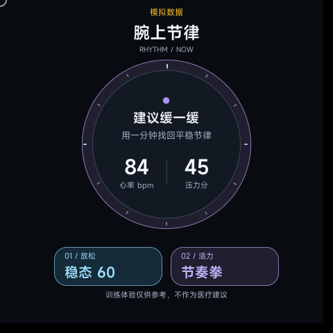
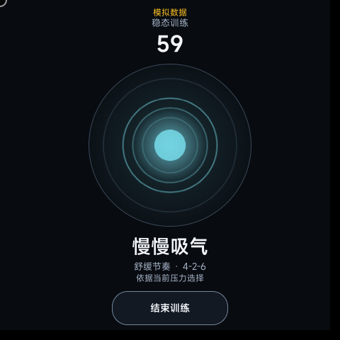
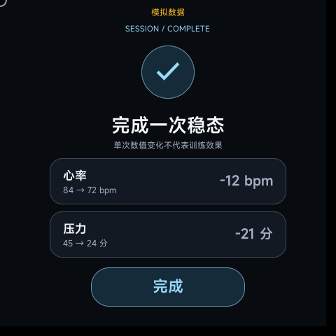
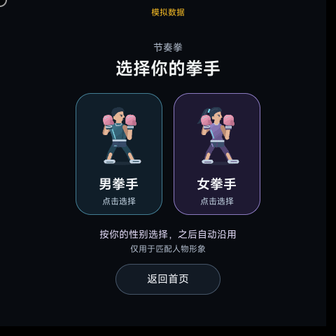
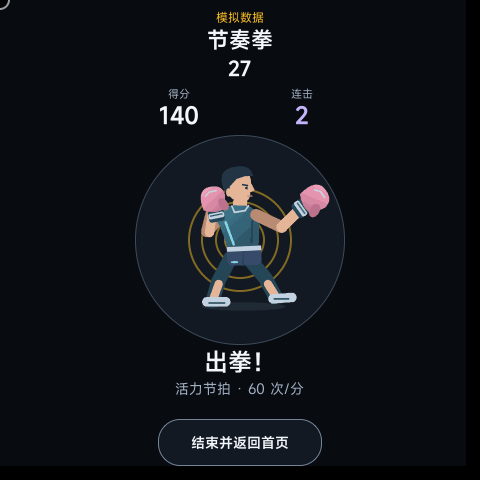
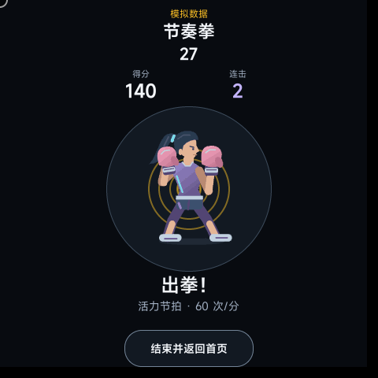
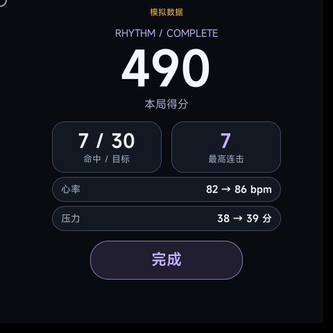
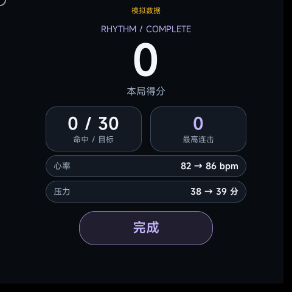

# 腕上节律

> 当前说明更新于 2026-11-01：[当前版本与验证范围](docs/current-version-20261101.md)、[新版截图及来源](docs/images/20261101/README.md)。历史报告、视频与旧安装包记录保留原日期，不代替本次版本验证。

面向 openvela 手表的身心训练快应用。当前版本包含“稳态 60”和“节奏拳”两个模式：前者用心率与压力驱动 60 秒呼吸训练，后者用单腕加速度动作完成 30 秒节拍挑战。

## 已完成功能

- 心率与压力最近值读取及实时订阅
- 高值与上升趋势的本地判定
- 主动开始或根据状态提示开始训练
- 标准节奏（4-2-4）与舒缓节奏（4-2-6）
- 依据训练期间压力和心率变化，在完整呼吸周期边界调整节奏
- 基于真实经过时间的 60 秒倒计时
- 逐项验证训练基线和本次新样本后展示前后差值；无有效对比显示“无法比较”
- 心率与压力独立过期、重复/乱序过滤，样本不足不宣称状态平稳
- 呼吸节奏选择原因随完整周期边界更新
- 健康数据不可用时的离线训练降级
- 加速度突变识别与 350ms 动作防抖
- 精准、良好、命中三级节拍评分与连击统计
- 根据实时心率降低出拳节拍速度
- 加速度计不可用时明确提示无法记录出拳，不产生模拟得分
- 480×480 圆形表盘安全区布局，并保留紧凑圆屏与短视口保护
- Prism 棱镜夜光视觉：曜石底色、青蓝呼吸、紫罗兰节奏拳与少量琥珀命中高光
- 随健康数据脉冲的首页生命仪表和随阶段变化的呼吸球
- 包含待机、出拳与命中反馈的男女拳手逐帧动画

本应用只提供放松训练，不用于疾病诊断或治疗。

## 当前界面（2026-11-01）

以下为 **2026-11-01 官方模拟器原生截图**，来自使用当前界面与训练逻辑的独立情景演示包，画面保留“模拟数据”标识。健康数值是预设情景，不是人体测量，也不代表训练效果；正式应用仍通过 `@service.health` 获取实际读数。

| 健康首页：压力45分 | 呼吸训练：吸气阶段 |
| --- | --- |
|  |  |

| 呼吸结果：45→24 | 男女拳手选择 |
| --- | --- |
|  |  |

| 男拳手训练 | 女拳手训练 |
| --- | --- |
|  |  |

| 节奏拳结果：38→39 | 无动作对照：0分 |
| --- | --- |
|  |  |

完整图片来源与哈希见 [截图说明](docs/images/20261101/README.md)。

## 环境

- Node.js 22 或更高版本
- AIoT IDE
- `aiot-core` 与 `aiot-emulator` 1.7.22 或更高版本
- 模拟器镜像：`vela-miwear-watch-5.0(开发者大赛)`

## 安装、测试与构建

```bash
npm install
npm test
npm run build
npm run build:release
```

`npm test` 运行训练算法与纯逻辑辅助测试、可执行的页面生命周期/系统适配集成测试、组件契约测试，以及带可注入工具链夹具的实际 `runRelease()` 编排测试。openvela `.ux` 无法在 Node.js 中直接挂载，因此组件测试会执行组件事件方法并检查语义化的 props、父页面事件和布局绑定，最终由开发构建验证 `.ux` 编译集成。

`npm run build` 生成调试包；`npm run build:release` 使用 JSC、PNG8 并保留诊断日志的评审参数生成发布包。大赛镜像 20260717 不识别缩写 CSS 属性，因此禁用 CSS 属性名压缩。两种构建均只暂存源码、签名与必要配置到临时 ASCII 目录，隔离历史录像、文档、其他工作树和备份，再通过临时目标原子发布结果。

本地构建可使用工具链或受控环境提供的演示签名，仅用于开发验证，并不等同于可分发签名。正式分发必须使用由发布方管理的凭据；仓库不提供分发凭据。

构建产物位于：

```text
dist/com.openvela.wristrhythm.debug.1.0.0.rpk
dist/com.openvela.wristrhythm.release.1.0.0.rpk
```

## 图标量化

图标优化脚本支持并固定 `Pillow==12.3.0`。在 PowerShell 中使用以下确切命令生成待检查的临时图标：

```powershell
python -m pip install -r requirements-icon.txt
python scripts/optimize-icon.py src/common/app-icon-512.png "$env:TEMP\wristrhythm-app-icon-512.png"
```

确认临时文件仍为 512×512、索引色且透明边缘和主体视觉无误后，再替换项目图标。

## 模拟器验收

1. 使用 AIoT IDE 打开本目录。
2. 新建并启动 `vela-miwear-watch-5.0(开发者大赛)` 模拟器。
3. 编译并推送应用。
4. 验证冷启动后心率和压力开始刷新。
5. 验证样本不足时不出现主动提示，高值或上升趋势时出现“建议缓一缓”。
6. 点击“开始 60 秒”，验证吸气、停留、呼气和倒计时。
7. 验证呼吸球随吸气扩大、停留悬浮、呼气收缩，阶段文字和底部操作不发生位移。
8. 验证 Prism 调色板：曜石底色，呼吸状态以青蓝为主，节奏拳控件以紫罗兰为主，琥珀用于目标与命中反馈，卡片边框保持低对比度。
9. 完整运行 60 秒，验证结果页前后值、差值和只播放一次的完成光环。
10. 训练或节奏拳进行时切换到后台，确认会话和视觉反馈暂停，健康订阅、加速度计、连接超时计时器和训练计时器均被释放；返回应用后，倒计时从剩余时间继续，并重新建立需要的订阅。
11. 在健康接口不可用场景下验证降级文案，确认呼吸训练仍可开始。
12. 进入“节奏拳”，验证选定男女拳手的待机、出拳与回防图片帧、命中冲击反馈，以及得分和连击更新；人物和提示始终位于圆屏安全区内。
13. 改变 Mock 心率，验证节拍从活力、平衡切换为舒缓速度。
14. 在不支持加速度计的设备上验证连接失败提示及返回/重试操作，不开始正常训练计时，也不生成完成成绩；点击人物不会产生得分。
15. 检查首页、两种训练和两个结果页，确认标题、指标、人物、提示和按钮均未被圆形边缘裁切，紧凑圆屏不发生裁切。

## 工程结构

```text
src/
  manifest.json                  手表、权限、后台订阅和路由
  common/app-icon-512.png        应用图标
  pages/index/index.ux           页面编排和会话/资源生命周期
  pages/index/components/        首页、呼吸、拳击和两个结果视图
  pages/index/steady.js          稳态判定和呼吸算法
  pages/index/health-core.js     健康数据纯规范化逻辑
  pages/index/health-quality.js  数据新鲜度、独立状态、去重及有效结果比较
  pages/index/health-adapter.js  可测试的健康系统调用与异常适配
  pages/index/health.js          service.health 系统适配
  pages/index/boxing.js          动作识别、评分和连击逻辑
  pages/index/motion.js          system.sensor 系统适配
  pages/index/session-clock.js   可暂停、可恢复的前台会话时钟
  pages/index/subscription-lifecycle.js 健康订阅所有权状态机
  pages/index/reactive.js        避免重复响应式写入
  pages/index/page-lifecycle.js  前台代际、资源清理与恢复边界控制器
test/steady.test.js              训练与拳击逻辑测试
test/runtime.test.js             时钟、订阅及响应式运行时测试
test/page-lifecycle.test.js      延迟回调、同步失败、清理和恢复集成测试
test/component-contract.test.js  组件 props、事件和布局装配契约测试
test/release-runner.test.js      发布构建和产物防陈旧测试
```

应用处于后台或被隐藏时会暂停当前会话，并释放健康、动作和计时器资源；再次显示时只恢复仍在进行的会话及其剩余时间。

## 加速度计兼容性

应用使用官方 `@system.sensor.subscribeAccelerometer({ interval: 'game' })`，不使用未公开的陀螺仪接口。官方支持列表显示该接口目前支持小米手环 9 / 9 Pro、小米手环 10和 Xiaomi Watch S5，其他设备可能不支持；应用会提示无法记录出拳且不会产生模拟得分，稳态训练不受影响。

接口文档：[Xiaomi Vela 传感器 sensor](https://iot.mi.com/vela/quickapp/zh/features/system/sensor.html)

## 拳手形象与首次选择

节奏拳包含男、女两套拳手，女拳手使用高马尾和紫蓝背心。两套形象共用原有训练时钟、出拳与回防节奏，不改变动作阈值、计分和训练时长。

每次从首页进入节奏拳时，应用优先使用可读取的表主性别；读取不到则沿用本地保存的选择。首次没有可用资料和保存记录时显示男女拳手卡片，点击后保存并开始训练。保存失败会提示重试，不会假装已经记住；返回首页或离开应用会取消等待，迟到的回调不会启动训练。

当前 SDK 和比赛镜像没有确认可用的公开表主资料接口。`profile.js` 仅对可选厂商 `health.getUserInfo` 扩展做能力检查；主机测试覆盖该适配，不能据此宣称已从手表或绑定手机读到性别。当前官方模拟器使用首次选择与 `system.storage` 保存路径。字符串 `male/female/男/女` 可识别，未经确认的数字性别枚举不做推断。

女拳手新增 8 张待机、12 张出拳帧。正常构建使用已提交的 PNG；重新生成时运行：

```powershell
node scripts/generate-female-fighter.js --playwright <已有Playwright模块路径> --python <已有且带Pillow的Python路径>
```

验收记录见 [女拳手与性别匹配](docs/boxing-gender-20261014.md)。
