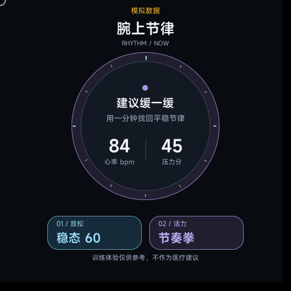
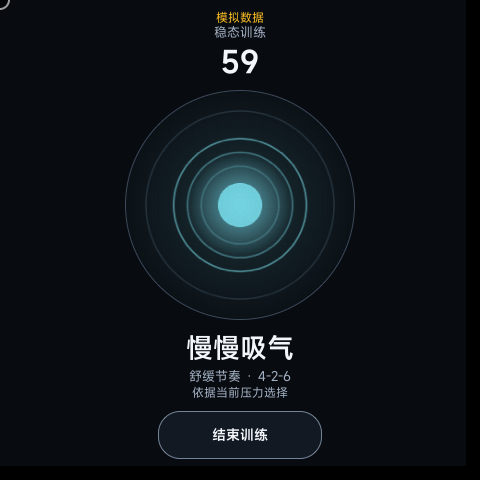
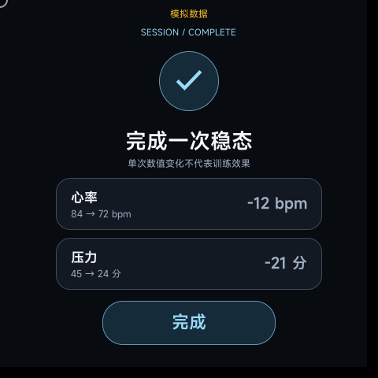
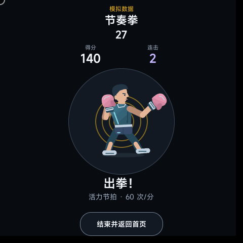
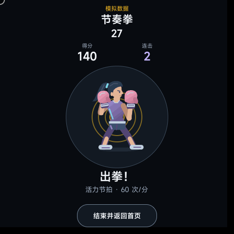
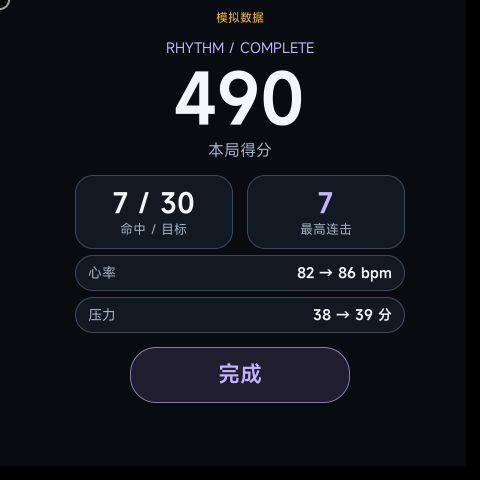
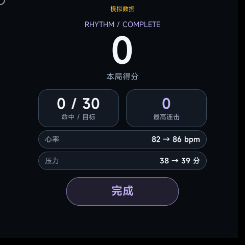

# 新版截图与来源（2026-11-01）

以下为 **2026-11-01 官方模拟器原生截图**，来自使用当前界面与训练逻辑的独立情景演示包，画面保留“模拟数据”标识。健康数值是预设情景，不是人体测量，也不代表训练效果；正式应用仍通过 `@service.health` 获取实际读数。

本目录仅保存从原始截图逐字节复制的8张PNG，均为480×480；没有裁切、重绘、叠字或修改数值。图片中的“模拟数据”来自演示包自身的原生渲染。

| 健康首页：压力45分 | 呼吸训练：吸气阶段 |
| --- | --- |
|  |  |

| 呼吸结果：45→24 | 男女拳手选择 |
| --- | --- |
|  |  |

| 男拳手训练 | 女拳手训练 |
| --- | --- |
|  |  |

| 节奏拳结果：38→39 | 无动作对照：0分 |
| --- | --- |
|  |  |

## 图片核验

| 文件 | 本机原始截图记录 | SHA-256 |
| --- | --- | --- |
| `home-preview.png` | `breathing/screenshots/01-home.png` | `e12bcd7055e6da78de13358d5da34b4a127e2e03cba35091e0ec1b374745ca8c` |
| `steady-training.png` | `breathing/screenshots/02-inhale.png` | `8fa43c7cb1a919202fdc7c22c56ca807533afa59d05a25ec9b9f01aa37c6dbcc` |
| `steady-result.png` | `breathing/screenshots/05-result.png` | `e56bc17a7dd699632e5e10319dc01b20cc1bd7750ec6721fdcd7a292fdd66ad6` |
| `fighter-choice.png` | `boxing-female/screenshots/02-choice.png` | `dc0876910aedb1208e6a6ae1c911130f8fa1c267b4dabf246bf0673c139fe68c` |
| `boxing-training.png` | `boxing-male/screenshots/04-combo.png` | `248e239fdf5f1b9d7c75e4e4c9e6ab43ad852cadd176222e3a66829e9f533b90` |
| `boxing-female-training.png` | `boxing-female/screenshots/04-combo.png` | `f215471feca8c1f3a15beb34b14cce863d5881a2ea94038017e78258711a1436` |
| `boxing-result.png` | `boxing-male/screenshots/05-result.png` | `77f2da2c03797b671e2915019d05a6575a873fa9eab13c7588589ceb62421943` |
| `boxing-zero-control.png` | `boxing-zero/screenshots/05-result.png` | `d2cc2743b67842824e8a08e5afb1be3c42c331eef4da6f64b743add23aea2930` |

原始记录位于开发工作区的 `output/stress-simulation-20261101/`，图片清单、构建来源及场次记录在本机保留；这些输出、演示RPK、PPT和模拟器对话日志不随本次文档PR上传。演示实现基于 `f418010`，仅替换独立包的健康适配器，沿用训练时钟、结果计算、动作传感器输入及评分逻辑。

呼吸情景为压力45→24，节奏拳为38→39；这些是构造的输入轨迹，不是人体数据，也不证明训练会产生相同结果。当前正式安装包的记录见 [当前版本说明](../../current-version-20261101.md)。
